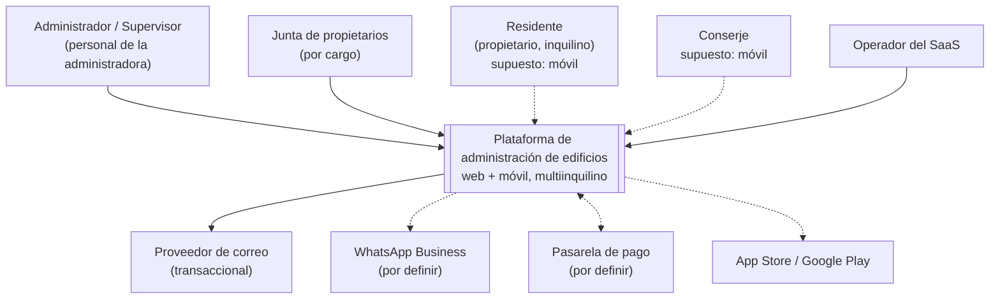
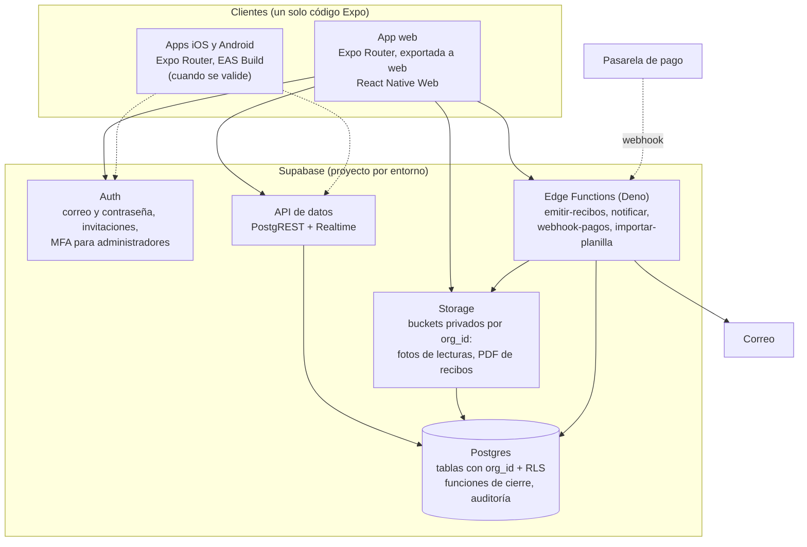
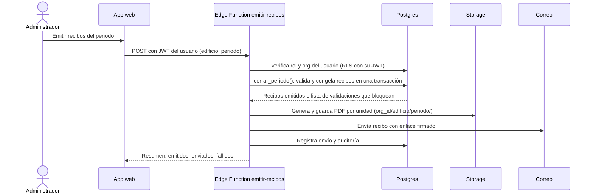
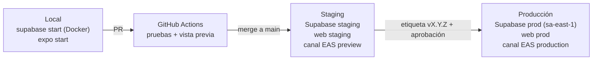

JTM — IT & Business Analytics

DOCUMENTO DE TRABAJO

# Arquitectura de la plataforma de administración de edificios

**T&C Administración y Gestión Inmobiliaria S.A.C.**

| | |
|---|---|
| Cliente | T&C Administración y Gestión Inmobiliaria S.A.C. |
| Preparado por | JTM — IT & Business Analytics |
| Versión | 0.1 |
| Fecha | 2026-10-17 |
| Estado | Borrador |
| Confidencialidad | Confidencial |
| Tipo | arc42 + C4 (niveles 1 y 2) + ADR |

---

## 1. Resumen y recomendación

Una sola base de código en **Expo con Expo Router** (React Native + TypeScript) para la web del administrador y, cuando se valide, las apps de iOS y Android. Detrás, **Supabase**: Postgres como única fuente de verdad, Auth para las cuentas, **políticas de seguridad por fila (RLS) con `org_id` en cada tabla** para aislar a cada administradora, Storage para las fotos de lecturas y los PDF de recibos, y Edge Functions para lo que no puede correr en el cliente (emitir recibos en lote, notificar, recibir avisos de la pasarela de pago).

El aislamiento entre inquilinos vive en la base de datos, no en la pantalla, y se prueba de forma automática en cada cambio. Un error en el cliente no puede mostrar datos de otra administradora.

Tres entornos (local, staging, producción), un solo repositorio, despliegue con GitHub Actions y EAS. Las decisiones están en la sección 9 como ADR breves; dos quedan propuestas hasta confirmar con T&C: el hosting de la web y la pasarela de pago.

## 2. Metas y restricciones

### 2.1 Metas de calidad

| Prioridad | Meta | Escenario que la mide |
|---|---|---|
| 1 | **Aislamiento entre inquilinos** | Un usuario autenticado de la administradora A consulta cualquier tabla con cualquier filtro y no recibe ni una fila de B. Probado en CI. |
| 2 | **Corrección del dinero** | El total de un cierre mensual es igual a la suma de sus recibos, y la suma de participaciones del edificio es 100 %. Sin redondeos en el cliente. |
| 3 | **Trazabilidad** | Todo cambio sobre datos financieros queda en el registro de auditoría con usuario, fecha, antes y después. |
| 4 | **Usabilidad** | Contraste de 4.5:1, texto base de 14 px, un solo botón primario por vista, error junto al campo (criterios de la evaluación heurística). |
| 5 | **Costo bajo de cambiar de plataforma** | Llevar una pantalla web al móvil no exige reescribirla. |

### 2.2 Restricciones

| Restricción | Origen |
|---|---|
| Multiinquilino: cada administradora opera aislada y contrata un plan | Documento de partida, sección 6 |
| Versión 1: web del administrador; móvil fuera de alcance pero posible | Documento de partida, sección 1; Visión y alcance §5 |
| Datos personales de residentes (nombres, documentos, teléfonos) | Ley 29733 de Protección de Datos Personales del Perú; alcance exacto a revisar con asesoría legal |
| Moneda soles (S/), zona horaria America/Lima | Cartera de T&C |
| Equipo con experiencia previa en Expo y Supabase | Proyecto Ysique y plantilla `JTM_templates` (Expo SDK 57) |

## 3. Contexto y alcance (C4, nivel 1)



Figura 1. Contexto del sistema. Las líneas punteadas son supuestos o integraciones sin proveedor definido.

| Vecino | Qué intercambia | Estado |
|---|---|---|
| Proveedor de correo | Recibos, estados de cuenta, invitaciones, recuperación de contraseña | Necesario en v1; proveedor por elegir |
| WhatsApp Business | Aviso de recibo emitido con enlace de pago | El paso 4 del cierre lo menciona; proveedor y costo por definir |
| Pasarela de pago | Cobro en línea; aviso (webhook) de pago confirmado | Pregunta abierta P6 |
| Tiendas de apps | Publicación de las apps | Solo si se valida el móvil |

## 4. Estrategia de solución

| Problema | Estrategia |
|---|---|
| Web hoy, móvil quizá mañana | **Expo Router universal**: una base de código; la web se exporta desde el mismo proyecto. Las pantallas de escritorio y las de teléfono pueden ser distintas, pero comparten dominio, datos y componentes. |
| Aislar inquilinos sin depender de que el código lo recuerde | **RLS en Postgres** sobre `org_id`, con funciones de ayuda y pruebas pgTAP. |
| Reglas de dinero correctas | Cálculos de cierre y prorrateo en **funciones de Postgres** o Edge Functions, nunca en el cliente. Montos en `numeric(12,2)`. |
| Equipo chico, sin servidor propio que operar | **Supabase gestionado**: base, autenticación, archivos y funciones en un solo servicio. |
| Auditoría desde el día uno | **Triggers** que escriben en una tabla de auditoría inmutable. |
| Consistencia visual | Kit de componentes de `JTM_templates`: cuatro estados de todo lo tocable, color nunca como única señal, mínimo tocable de 44 px, contraste probado en `npm test`. |

## 5. Vista de bloques (C4, nivel 2)



Figura 2. Contenedores del sistema.

| Contenedor | Responsabilidad | Tecnología |
|---|---|---|
| App web | Toda la operación del administrador, la junta y el operador | Expo Router, React Native Web, TypeScript estricto |
| Apps móviles | Residente y conserje, si se valida | Mismo proyecto, EAS Build |
| Auth | Cuentas, sesiones, invitaciones a una administradora, MFA | Supabase Auth |
| API de datos | Lectura y escritura con la sesión del usuario; RLS decide qué ve | PostgREST (supabase-js) |
| Postgres | Fuente de verdad, reglas de aislamiento, cálculos de dinero, auditoría | Postgres 15+ con RLS, pgTAP en pruebas |
| Storage | Archivos privados, ruta que empieza por `org_id` | Supabase Storage con políticas |
| Edge Functions | Procesos con clave de servicio o con terceros | Deno, desplegadas con la CLI |

### 5.1 Módulos del cliente

Cada módulo sigue las capas que ya se usaron en Ysique: el dominio no depende de la pantalla ni de Supabase.

```
src/modulos/<modulo>/
  dominio/          reglas puras y tipos (sin React, sin Supabase), con pruebas unitarias
  aplicacion/       casos de uso y puertos (interfaces de repositorio)
  infraestructura/  adaptadores: Supabase, y uno falso para pruebas y demo
  ui/               pantallas y componentes del módulo
```

Módulos iniciales, uno por flujo de la Visión: `organizaciones` (inquilinos, usuarios, roles), `padron` (edificios, unidades, personas, espacios, medidores), `cobranza` (cierre, recibos, pagos, moras), `cartera` (inicio), `auditoria`.

Con el Sprint 3 los pagos salen de `cobranza` a su propio contexto, `pagos`, y se suman `residente` (portal del residente), `campo` (el personal en el edificio) y `notificaciones` (correo). El mapa de contextos, sus agregados y qué puede importar cada uno está en la skill `ddd-modulos` (`.claude/skills/ddd-modulos/SKILL.md`).

## 6. Vista de ejecución

### 6.1 Cierre mensual: emitir y notificar (paso 4)



Figura 3. Emisión de recibos. Las validaciones que bloquean se resuelven antes de llegar acá, en el paso 3; la función las vuelve a comprobar porque el cliente no es de confianza.

### 6.2 Inicio de sesión y elección de administradora

1. El usuario entra con correo y contraseña (Supabase Auth). Los administradores con MFA.
2. La app lee sus membresías (`membresia`): una o varias administradoras, con su rol en cada una.
3. Si tiene varias, elige con el selector de contexto ("Administradora ▾" del wireframe). La elección filtra las consultas; la RLS garantiza que, aunque el filtro faltara, solo vería las administradoras a las que pertenece.

## 7. Despliegue y entornos



Figura 4. Entornos y promoción.

| Entorno | Base de datos | Web | Móvil | Datos |
|---|---|---|---|---|
| Local | `supabase start` en Docker, `supabase db reset` aplica migraciones y semilla | `npx expo start --web` | Expo Go o development build | Semilla con datos de ejemplo, nunca reales |
| Staging | Proyecto Supabase propio | Despliegue automático desde `main` | Canal EAS `preview` (EAS Update) | Datos de prueba; nunca copia de producción con datos personales |
| Producción | Proyecto Supabase propio, región São Paulo (`sa-east-1`, la más cercana a Lima), plan con backups diarios y PITR | Despliegue al publicar una versión | Canal EAS `production`; tiendas si se valida | Reales |

Reglas:

- **Los cambios de esquema solo entran por migraciones** versionadas en `supabase/migrations/`. Nada se cambia a mano en el panel de staging o producción.
- **Configuración por variables de entorno** (12-factor). En el cliente solo van `EXPO_PUBLIC_SUPABASE_URL` y la clave pública (`anon`). La clave de servicio vive solo en los secretos de las Edge Functions y de GitHub.
- Las variables `EXPO_PUBLIC_*` se fijan al construir: cambiar de entorno pide construir otra vez.

### 7.1 CI/CD

| Disparador | Qué corre | Resultado |
|---|---|---|
| Cada push y PR | `tsc`, lint, pruebas unitarias del dominio; `supabase start` + `supabase db reset` + `supabase test db` (pgTAP, incluidas las de RLS); `supabase db lint`; `expo export --platform web` | El PR no se puede fusionar si algo falla |
| PR (opcional) | Vista previa de la web; `eas update --channel pr-<n>` si hay móvil | Enlace para revisar |
| Merge a `main` | `supabase db push` y `supabase functions deploy` a staging; web a staging; `eas update --channel preview` | Staging al día con `main` |
| Etiqueta `vX.Y.Z` | Lo mismo contra producción, detrás de un *environment* de GitHub con aprobación manual | Versión publicada |
| Cambio nativo (huella distinta) | `eas build` + `eas submit` | Binario nuevo; solo cuando cambian dependencias nativas |

Las apps usan `runtimeVersion` con política `fingerprint`: EAS Update solo entrega una actualización a binarios compatibles, y un cambio nativo obliga a un build nuevo.

## 8. Conceptos transversales

### 8.1 Aislamiento multiinquilino

- **Cada tabla de negocio tiene `org_id uuid not null`**, con índice. Las tablas hijas lo repiten (no se deduce por join) para que la política sea simple y rápida.
- **La pertenencia se resuelve en una sola función**, en un esquema no expuesto:

  ```sql
  create function private.mis_orgs() returns setof uuid
  language sql stable security definer set search_path = '' as $$
    select org_id from public.membresia
    where usuario_id = (select auth.uid()) and activa
  $$;

  alter table public.unidad enable row level security;
  create policy unidad_lectura on public.unidad for select to authenticated
    using (org_id in (select private.mis_orgs()));
  ```

  Las políticas de escritura agregan el rol: `private.tiene_rol(org_id, 'administrador')`.
- **Alcance por rol dentro de la administradora** (supuesto de PB-04): el administrador lee y escribe todo; el personal lee todo y no escribe; el residente ve solo lo suyo. Por eso, desde que hay datos personales en la base, la lectura del padrón pide `org_id in (select private.orgs_del_equipo())` (administrador o personal) **o** que la fila sea del residente: `private.mis_personas()`, `private.mis_unidades()` y `private.edificios_de_mis_unidades()`, que parten de `persona.usuario_id` y respetan la membresía activa. `organizacion` sigue con `private.mis_orgs()`. Las pruebas están en `supabase/tests/04_alcance_por_rol.sql`.
- **Integridad entre inquilinos:** las claves foráneas incluyen `org_id` (`foreign key (org_id, edificio_id) references edificio (org_id, id)`), así una unidad no puede colgar de un edificio de otra administradora aunque alguien lo intente con la clave de servicio.
- **Acceso por edificio**, si T&C lo confirma (pregunta P4 de la Visión): una tabla `acceso_edificio` y una segunda función `private.mis_edificios()`, con el mismo patrón.
- **Storage:** buckets privados; la ruta empieza por `org_id` y la política compara `(storage.foldername(name))[1]::uuid` con `private.mis_orgs()`. Los recibos se comparten con enlaces firmados de vida corta.
- **Edge Functions:** usan el JWT del usuario por defecto, de modo que la RLS aplica. La clave de servicio solo para procesos sin usuario (webhook de pagos, tareas programadas), y en esos casos el `org_id` se toma del registro, nunca de la petición.
- **Pruebas:** por cada tabla, una prueba pgTAP que crea dos administradoras y comprueba que un usuario de una no lee, no inserta, no modifica y no borra filas de la otra. Una tabla nueva sin su prueba no pasa la revisión.

### 8.2 Autenticación y roles

Supabase Auth con correo y contraseña e invitación por correo para entrar a una administradora. MFA (TOTP) obligatorio para administradores y operador. Los roles viven en `membresia.rol`; la lista final depende de la pregunta P4 de la Visión.

### 8.3 Dinero

Montos en `numeric(12,2)`, moneda soles. El prorrateo, las moras y los totales del cierre se calculan en Postgres; el cliente muestra, no calcula. Cada recibo emitido se congela: corregirlo es emitir una nota o un ajuste, no editarlo.

### 8.4 Auditoría

Trigger genérico en las tablas de negocio que escribe en `auditoria` (tabla, fila, `org_id`, usuario, acción, antes, después, fecha). La tabla no admite `update` ni `delete` para nadie. Es una de las fortalezas del portal actual.

### 8.5 Accesibilidad y diseño

Los criterios de la evaluación heurística como reglas del kit: contraste 4.5:1, texto base 14 px, íconos con etiqueta, estados con texto, un solo primario por vista, eliminar con deshacer. El kit de `JTM_templates` ya prueba el contraste de forma automática.

### 8.6 Errores y validación

Validación en el campo, con mensaje junto a él (H9). Las reglas se comprueban en el cliente para responder rápido y en la base (restricciones y funciones) para que sean ciertas.

## 9. Decisiones (ADR)

### ADR-001. Expo Router universal para web y móvil

**Estado:** aceptada.
**Contexto:** la versión 1 es web; el móvil es un supuesto a validar. El equipo ya trabajó con Expo en Ysique y tiene la plantilla `JTM_templates`.
**Decisión:** un proyecto Expo con Expo Router y TypeScript estricto; la web se exporta del mismo proyecto.
**Consecuencias:** una base de código, un kit de componentes, un dominio. Las tablas densas en web se hacen con React Native Web; si alguna pantalla lo necesita, se usa un componente solo web. El SEO no importa: todo está detrás de un inicio de sesión.

**Alternativas descartadas:**

| Opción | A favor | En contra |
|---|---|---|
| Next.js para la web + React Native aparte | El mejor ecosistema web; renderizado en servidor | Dos bases de código, dos kits y dos equipos para el mismo dominio; el renderizado en servidor no aporta en una app privada |
| Flutter | Una base de código; buen rendimiento móvil | En web dibuja en un canvas: peor accesibilidad, selección de texto y comportamiento de tablas largas, que son el centro del trabajo del administrador. El equipo no trabaja en Dart |
| Solo web (PWA) | Lo más simple para la v1 | Cámara, notificaciones y uso sin conexión limitados en iOS; si el móvil se valida, hay que reescribir |

### ADR-002. Supabase como backend

**Estado:** aceptada.
**Contexto:** equipo chico, necesidad de base relacional (dinero, prorrateo, auditoría), aislamiento fuerte y archivos.
**Decisión:** Supabase gestionado: Postgres, Auth, Storage, Edge Functions.
**Consecuencias:** no hay servidor propio que mantener; la lógica sensible se escribe en SQL y en funciones Deno. Dependencia de un proveedor, mitigada porque el núcleo es Postgres estándar y se puede migrar con un volcado.
**Alternativas descartadas:** API propia (NestJS o similar) sobre Postgres gestionado, que da más control pero exige escribir y operar autenticación, archivos y permisos; Firebase, que no es relacional y hace difícil el dinero y los reportes.

### ADR-003. Aislamiento por fila con `org_id`, no por esquema ni por base

**Estado:** aceptada.
**Contexto:** muchas administradoras chicas y medianas, mismo esquema para todas.
**Decisión:** una sola base, `org_id` en cada tabla y RLS.
**Consecuencias:** una migración sirve para todos los inquilinos; los reportes del operador son simples. El riesgo de fuga se cubre con RLS obligatoria y pruebas. Si un cliente grande exige base propia, se le da un proyecto Supabase aparte con el mismo código.
**Alternativas descartadas:** un esquema por inquilino (migraciones multiplicadas) y un proyecto por inquilino (costo y operación por cliente).

### ADR-004. Pertenencia por tabla y función, no por claims en el JWT

**Estado:** aceptada.
**Contexto:** un usuario puede pertenecer a varias administradoras y perder el acceso en cualquier momento.
**Decisión:** la RLS consulta `membresia` a través de `private.mis_orgs()`.
**Consecuencias:** quitar un acceso tiene efecto inmediato, sin esperar a que caduque un token. Costo: una consulta por política, que Postgres cachea dentro de la sentencia al envolverla en `select`. Si el rendimiento lo exige, se agrega un claim con un *Custom Access Token Hook* sin cambiar las políticas.

### ADR-005. Un solo repositorio, sin monorepo con espacios de trabajo

**Estado:** aceptada.
**Decisión:** un repo con la app Expo, `supabase/` (migraciones, funciones, pruebas, semilla) y `e2e/`.
**Consecuencias:** un PR lleva la migración, la función y la pantalla juntas. Se pasa a un monorepo (npm workspaces) solo cuando aparezca un segundo paquete desplegable, por ejemplo un sitio comercial.

```
/
  src/app/               rutas de Expo Router (solo rutas)
  src/modulos/           un módulo por flujo (dominio, aplicacion, infraestructura, ui)
  src/ui/                el kit de componentes (de JTM_templates)
  supabase/
    migrations/          SQL versionado
    functions/           Edge Functions
    tests/               pruebas pgTAP (RLS, cierre, auditoría)
    seed.sql             datos de ejemplo para local
  e2e/                   pruebas de punta a punta (Playwright para web)
  .github/workflows/     CI/CD
  app.config.ts, eas.json
```

### ADR-006. Lógica de dinero en el servidor

**Estado:** aceptada.
**Decisión:** el cierre, el prorrateo y las moras se calculan en funciones de Postgres llamadas por RPC o desde Edge Functions.
**Consecuencias:** un solo lugar donde la regla es cierta, probado con pgTAP. El cliente puede mostrar una vista previa, pero el número que vale es el del servidor.

### ADR-007. Hosting de la web

**Estado:** propuesta.
**Opciones:** EAS Hosting (mismo proveedor que los builds, vistas previas por PR) o Cloudflare Pages (estático, red amplia, plan gratuito generoso). Ambas sirven la exportación de Expo.
**Recomendación:** EAS Hosting, para tener un solo proveedor del lado del cliente. Se decide con el costo a la vista antes del primer despliegue a staging.

### ADR-008. Pasarela de pago

**Estado:** abierta, depende de la pregunta P6 de la Visión.
**Lo que ya se decide:** la confirmación de pago entra solo por webhook firmado a una Edge Function; el cliente nunca marca un pago como confirmado.

## 10. Calidad: cómo se prueba

| Nivel | Herramienta | Qué cubre |
|---|---|---|
| Dominio | Pruebas unitarias en TypeScript | Reglas puras de cada módulo |
| Base de datos | pgTAP (`supabase test db`) | RLS por tabla, funciones de cierre, auditoría |
| Punta a punta web | Playwright | Flujos clave: entrar, cierre mensual, ficha de la unidad |
| Punta a punta móvil | Maestro, cuando haya móvil | Flujos del residente y el conserje |
| Accesibilidad | Prueba de contraste del kit y revisión con lector de pantalla | Criterios de la evaluación |

## 11. Riesgos técnicos y deuda conocida

| Riesgo | Mitigación |
|---|---|
| Una tabla nueva queda sin RLS | Prueba en CI que falla si alguna tabla del esquema `public` no tiene RLS activada o no tiene su prueba de aislamiento |
| Tablas largas lentas en React Native Web | Paginación en servidor y listas virtualizadas; medir con datos del tamaño de T&C (edificios de hasta 59 unidades) multiplicado por la cartera |
| Dependencia de Supabase | Postgres estándar; migraciones y funciones en el repo; volcados periódicos |
| Clave de servicio filtrada | Solo en secretos de funciones y de GitHub; rotación documentada en un runbook |
| Datos personales en entornos de prueba | Prohibido copiar producción a staging; semillas sintéticas |

## 12. Glosario

| Término | Significado |
|---|---|
| Inquilino / administradora / organización | Una empresa cliente del SaaS. En la base, una fila de `organizacion`, identificada por `org_id`. No confundir con el inquilino de una unidad (residente que alquila) |
| Unidad | Departamento, local u otro inmueble de un edificio. El portal actual lo llama "bloque inmobiliario" |
| Fondo | Lo que el portal actual llama "bolsa" |
| Pago | Lo que el portal actual llama "voucher" |
| RLS | Row Level Security: políticas de Postgres que deciden qué filas ve y modifica cada usuario |
| C4 | Modelo de diagramas de arquitectura en niveles: contexto, contenedores, componentes, código |
| ADR | Architecture Decision Record: registro breve de una decisión, su contexto y sus consecuencias |
| EAS | Expo Application Services: Build (binarios), Submit (tiendas), Update (actualizaciones por aire) |

## Fuentes

- `sources/documents/Evaluacion-inmobiliario-Propuesta.md`: secciones 1, 4, 5 y 6; Figuras 3, 27–29.
- Documento `entregables/2026-10-17 Visión y alcance.md` de este proyecto.
- Plantilla `JTM_templates` (Expo SDK 57, expo-router, kit con contraste probado) y la arquitectura del proyecto Ysique (capas por módulo, Supabase, Edge Functions).

## Historial de versiones

| Versión | Fecha | Cambio |
|---|---|---|
| 0.1 | 2026-10-17 | Primera versión. |
